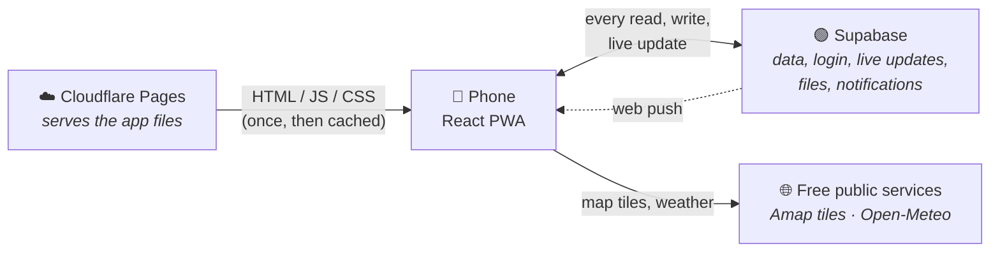

# Burglars in China: design docs

A trip app for a group of friends on a 20-day China trip. It's a PWA (a web app you add to your home screen) with a Supabase backend and Cloudflare Pages hosting.

| Doc | What you'll learn |
|---|---|
| [architecture.md](architecture.md) | The big picture: every moving part and who does what |
| [supabase-vs-cloudflare.md](supabase-vs-cloudflare.md) | Exactly what Supabase and Cloudflare each take care of |
| [data-model.md](data-model.md) | Database tables and how they relate |
| [flows.md](flows.md) | Step-by-step sequence diagrams: join, live updates, Bolleke, push, tickets |
| [offline.md](offline.md) | What works without signal and how it is cached |
| [security.md](security.md) | Who can read and write what |
| [frontend.md](frontend.md) | The React code: screens, state and libraries |

## The app in one picture

**Short version:** Cloudflare only delivers the app's files. Everything that is *data* (trip, chat, votes, locations, tickets, logins, notifications) lives in Supabase. The phone talks to Supabase directly. There is no custom server of our own.

## Tech stack

| Layer | Choice |
|---|---|
| UI | React 18, TypeScript, Vite |
| PWA / offline | `vite-plugin-pwa` (Workbox service worker in [src/sw.ts](../src/sw.ts)) |
| Map | Leaflet + Amap (AutoNavi) tiles, GCJ-02 conversion |
| Weather | Open-Meteo (no key) |
| Exchange rates | Frankfurter (no key) |
| Translation | MyMemory (no key) + the phone's speech features |
| Backend | Supabase: Postgres, Auth, Realtime, Storage, Edge Functions |
| Hosting | Cloudflare Pages |
| Notifications | Web Push (VAPID) from a Supabase Edge Function |

No Google services are used by the app itself, so it works from inside China. The one caveat: Android push is delivered through Google's push service, which needs the roaming eSIM's data route.
