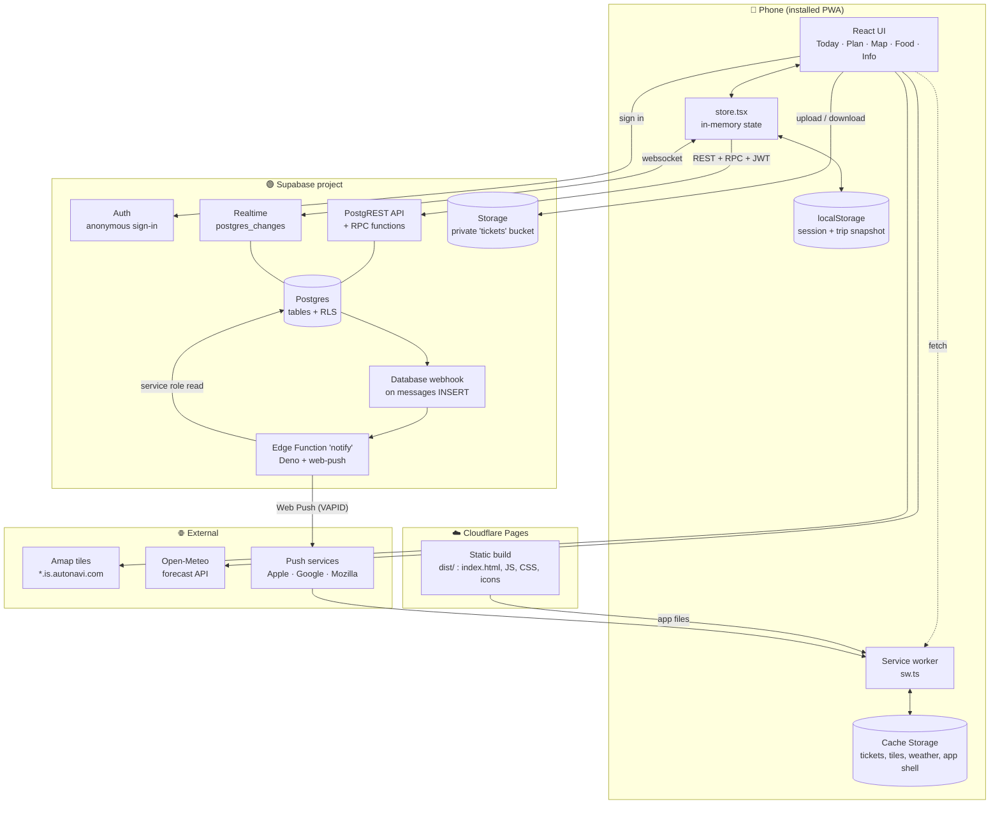
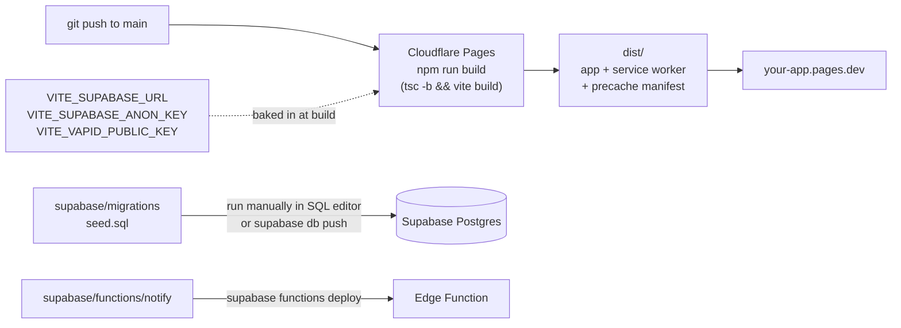

# Architecture

## System overview

## Design principles

1. **No custom server.** The browser talks straight to Supabase. Security is enforced in the database with Row Level Security, not in app code. See [security.md](security.md).
2. **Load everything, keep it fresh.** A trip is small (a few hundred rows), so the app loads all tables once, saves a copy on the phone, and refetches a table whenever Realtime says it changed. There is no per-screen data fetching.
3. **Offline first for read.** Schedule, hotels and tickets are readable with no signal. Writes need a connection.
4. **No accounts.** Friends join with a trip code and a display name. A phone is identified by an anonymous Supabase Auth user.
5. **Free tier friendly.** Cloudflare Pages, Supabase free plan, Open-Meteo and Amap tiles cost nothing.

## Runtime parts

| Part | Where it runs | Source |
|---|---|---|
| React app | Phone browser | [src/](../src) |
| Service worker | Phone browser (background) | [src/sw.ts](../src/sw.ts) |
| Database, auth, realtime, storage | Supabase | [supabase/migrations/0001_init.sql](../supabase/migrations/0001_init.sql) |
| Notification sender | Supabase Edge Function (Deno) | [supabase/functions/notify/index.ts](../supabase/functions/notify/index.ts) |
| Static hosting | Cloudflare Pages | `dist/` from `npm run build` |

## Build and deploy pipeline

The frontend and the backend deploy **independently**. Pushing to `main` only redeploys the frontend. Database and function changes are applied through the Supabase CLI or SQL editor.
