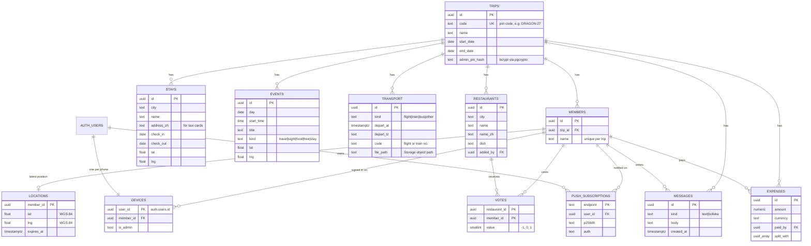
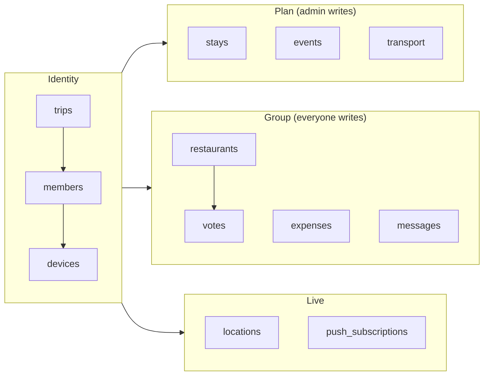

# Data model

Defined in [supabase/migrations/0001_init.sql](../supabase/migrations/0001_init.sql). Every table except `trips`, `devices` and `push_subscriptions` is also published to Supabase Realtime.

## Entity relationship diagram

## Table groups

## Design notes

- **Every row carries `trip_id`.** This makes RLS checks and Realtime filters cheap (`trip_id=eq.…`) and allows several trips in one database.
- **`devices` separates a phone from a person.** One member can be signed in on several phones. Admin rights belong to a *device*, so choosing someone's name never grants admin.
- **`votes.value = 0`** means "vote removed". The row is kept so Realtime can broadcast the change (a DELETE would not carry the trip filter reliably).
- **`locations` has one row per member.** Each Bolleke ping is an upsert, so the table never grows. `expires_at` decides whether a pin is still shown.
- **GPS stays WGS-84 in the database.** The app converts to GCJ-02 only when drawing on Amap tiles ([gcj.ts](../src/lib/gcj.ts)).
- **`transport` stores `timestamptz` plus a time zone name** per end, so a flight from Brussels to Beijing shows each time in its local zone.
- **Ticket files are not in a table.** `transport.file_path` points to an object in the `tickets` Storage bucket.

## Tables added later

| Table / column | Migration | Purpose |
|---|---|---|
| `trips.timezone` | 0002 | Zone in which trip days start; the morning summary goes out at 08:00 there. Default `Asia/Shanghai`. |
| `push_log (trip_id, key)` | 0002 | One row per timed notification already sent (`daily:<date>`, `transport:<id>:<depart_at>`, `event:<id>:<day>T<time>`). Not readable through the API. |
| `messages.image_path`, `messages.poll_options` | 0003 | A chat message is now one of four kinds: `text`, `bolleke`, `image` (has `image_path`) or `poll` (body is the question, `poll_options` the 2 to 6 answers). Check constraints keep kind and columns in step. |
| `poll_votes (message_id, member_id, choice)` | 0003 | One answer per member per poll. `choice` is the position in `poll_options`; `null` means the vote was taken back (same reason as `votes.value = 0`). Published to Realtime. |
| Storage bucket `media` | 0003 | Photos shared by the group, at `<trip_id>/<folder>/<file>`. 50 MB per file. |
| `album_items` | 0004 | One row per photo or video in the shared album: `kind`, `path` and `thumb_path` in the `media` bucket, `caption`, `taken_at`. Published to Realtime. |

## Helper functions

| Function | Type | Purpose |
|---|---|---|
| `current_member_id()` | SQL, security definer | Member behind `auth.uid()` |
| `current_trip_id()` | SQL, security definer | Trip behind `auth.uid()` |
| `is_trip_member(t)` | SQL, security definer | Used in every read policy |
| `is_trip_admin(t)` | SQL, security definer | Used in plan-table write policies |
| `join_trip(code, name)` | RPC | Create/find member and link this phone |
| `claim_admin(pin)` | RPC | Verify PIN with bcrypt, set `is_admin` on this device |
| `trip_preview(code)` | RPC | Show trip name on the join screen |
