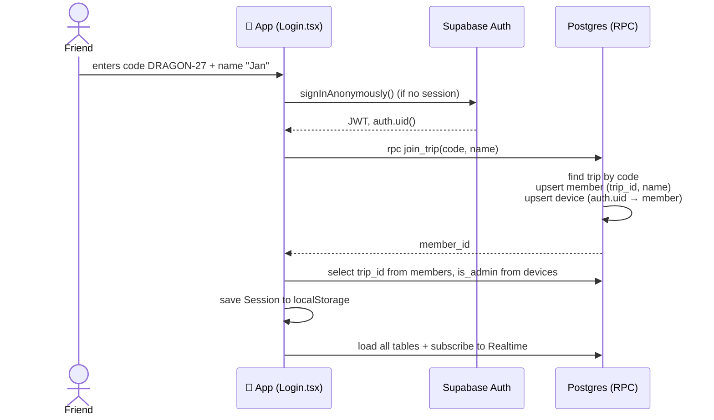
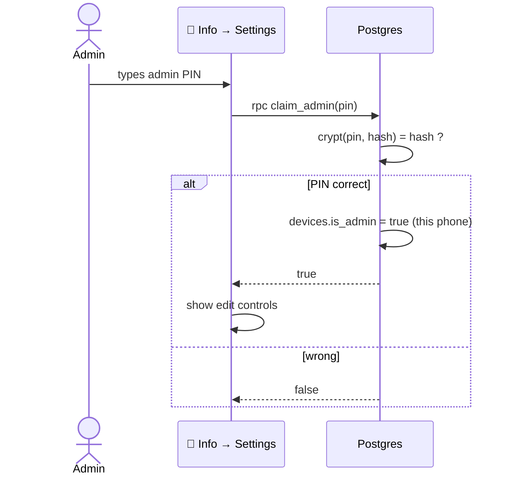
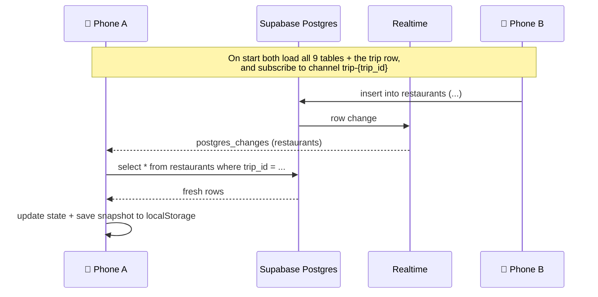
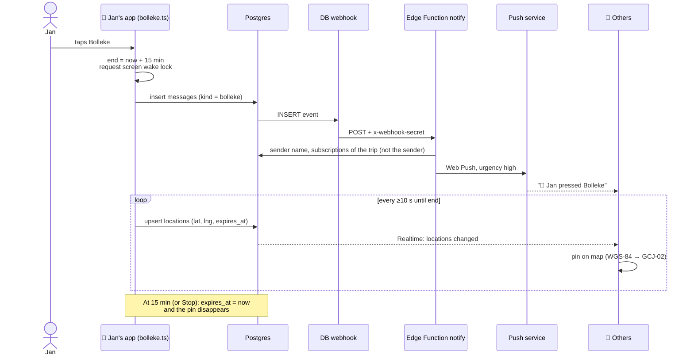
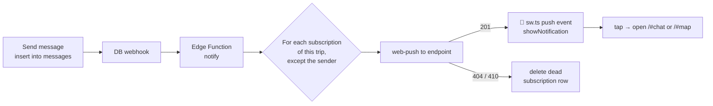
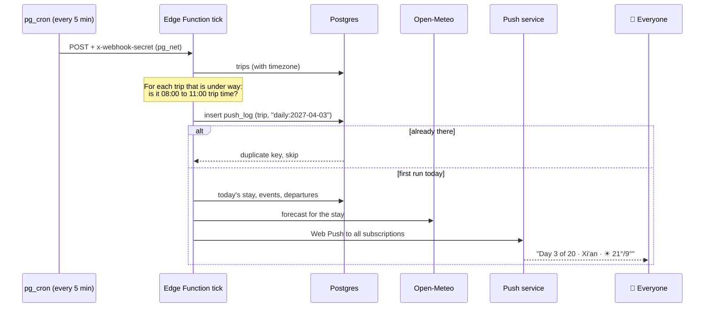
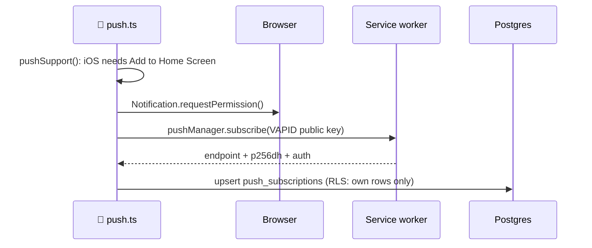
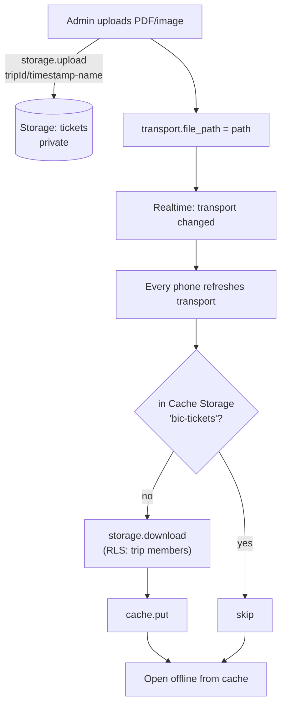
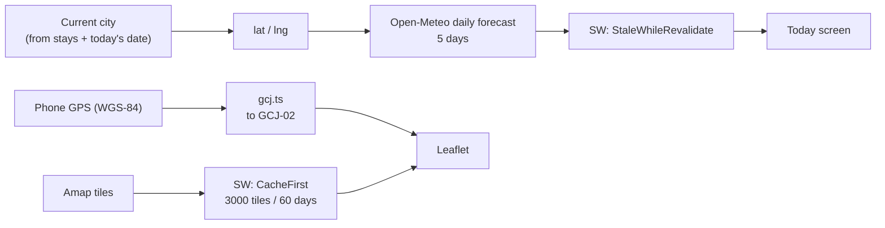

# Key flows

## 1. Joining a trip

No email or password. A phone signs in anonymously, then links itself to a member with the trip code.

Re-joining with the same name on a new phone attaches that phone to the existing member. Switching to a different name on the same phone resets `is_admin` to false.

## 2. Unlocking admin

The PIN is never sent back to the client and is stored only as a bcrypt hash. RLS then lets this device write `stays`, `events` and `transport`.

## 3. Loading and live updates

The event only says *which table* changed. The app then refetches that table. Beyond that, a full refresh also runs when the app becomes visible again and when the phone comes back online, which covers any events missed while the websocket was asleep.

## 4. Bolleke: share location and alert everyone

Limits worth knowing: the browser only gives GPS while the app is open, so the screen is kept awake while sharing. If the page is backgrounded, updates pause until it is visible again.

## 5. Chat notification

## 5b. Morning summary

Nothing in the app triggers this one. A schedule inside Postgres calls the `tick` function every 5 minutes, and the function decides whether anything is due.

The `push_log` insert is the lock: whichever run inserts the key sends the notification, and later runs see the duplicate and skip. The three-hour window means a missed run at 08:00 is caught by the next one.

## 6. Enabling notifications on a phone

## 7. Tickets

## 8. Weather and map

