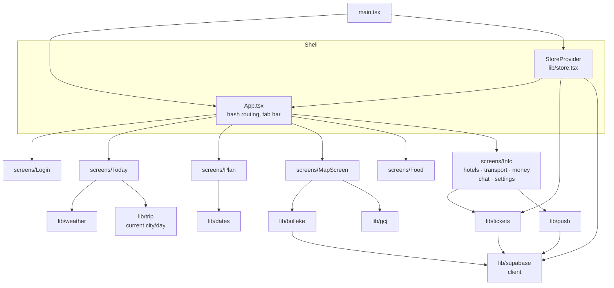

# Frontend

React 18 + TypeScript + Vite. About 1,600 lines in [src/](../src). There is no router library and no state library: the URL hash picks the screen and one context holds the data.

## Component and module map

## Routing

The location hash drives everything, so notification taps can deep-link (`/#map`, `/#chat`).

| Hash | Screen |
|---|---|
| `#today` (default) | Today |
| `#plan` | Plan |
| `#map` | Map + Bolleke |
| `#food` | Food |
| `#info` | Info menu |
| `#hotels`, `#transport`, `#money`, `#chat`, `#settings` | Info sub-pages |

## State

[store.tsx](../src/lib/store.tsx) exposes one context:

| Field | Meaning |
|---|---|
| `session` | `{ memberId, tripId, name, isAdmin }` or null |
| `data` | `trip` plus 9 arrays: members, stays, events, transport, restaurants, votes, expenses, messages, locations |
| `online`, `syncedAt` | Connection state and last full sync time |
| `join`, `claimAdmin`, `signOut` | Auth actions (RPCs) |
| `refresh(key?)` | Refetch all tables, or one |
| `memberName(id)` | Id → display name |

Screens read from `data` and write directly with `supabase.from(...)`. The Realtime subscription then triggers `refresh(table)`, so the UI updates from the same path whether the change was local or remote.

## Libraries

| File | Responsibility |
|---|---|
| [supabase.ts](../src/lib/supabase.ts) | Client with persisted anonymous session |
| [store.tsx](../src/lib/store.tsx) | Load, snapshot, realtime, join/admin |
| [bolleke.ts](../src/lib/bolleke.ts) | 15-minute geolocation watch, wake lock, upsert every ≥10 s |
| [push.ts](../src/lib/push.ts) | Capability check, subscribe/unsubscribe |
| [tickets.ts](../src/lib/tickets.ts) | Upload, download, offline cache |
| [weather.ts](../src/lib/weather.ts) | Open-Meteo hook and icon mapping |
| [gcj.ts](../src/lib/gcj.ts) | WGS-84 → GCJ-02 |
| [trip.ts](../src/lib/trip.ts), [dates.ts](../src/lib/dates.ts) | Current city/day logic, date helpers |
| [types.ts](../src/lib/types.ts) | Row types mirroring the SQL schema |
| [sw.ts](../src/sw.ts) | Service worker: precache, runtime caches, push, notification click |

## Environment variables

| Variable | Used by |
|---|---|
| `VITE_SUPABASE_URL` | [supabase.ts](../src/lib/supabase.ts) |
| `VITE_SUPABASE_ANON_KEY` | [supabase.ts](../src/lib/supabase.ts) |
| `VITE_VAPID_PUBLIC_KEY` | [push.ts](../src/lib/push.ts) |

If the first two are missing the app starts in an unconfigured state instead of crashing (`configured` flag).
