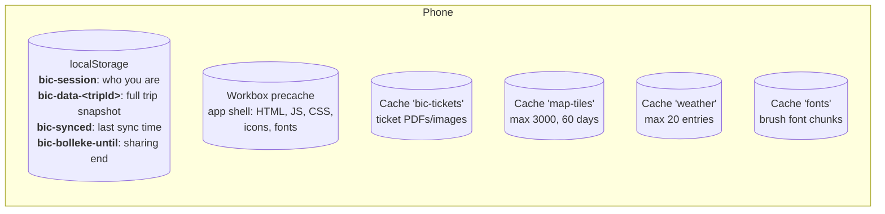
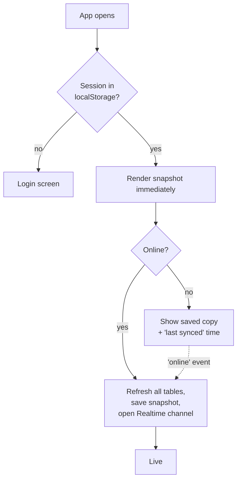

# Offline behaviour

The app is built for patchy signal on trains and in subways. Reading works offline; writing needs a connection.

## What is stored where

| Data | Mechanism | Strategy | Code |
|---|---|---|---|
| App shell | Workbox precache + navigation fallback to `/index.html` | Precached at install | [sw.ts](../src/sw.ts) |
| Trip rows (plan, hotels, food, expenses, chat) | `localStorage` JSON snapshot | Written after every refresh; read on start | [store.tsx](../src/lib/store.tsx) |
| Ticket files | Cache Storage `bic-tickets` | Downloaded when a transport row has a file, then served from cache | [tickets.ts](../src/lib/tickets.ts) |
| Shared photos | Cache Storage `bic-media` | Each photo or preview is kept after it has been shown once | [media.ts](../src/lib/media.ts) |
| Exchange rates | `localStorage` `bic-rates` | Last fetched rates; refreshed when older than 6 hours | [money.ts](../src/lib/money.ts) |
| Map tiles | Cache Storage `map-tiles` | CacheFirst: tiles you have looked at | `sw.ts` |
| Weather | Cache Storage `weather` | StaleWhileRevalidate | `sw.ts` |
| Brush font | Cache Storage `fonts` | CacheFirst | `sw.ts` |

## Startup decision

## What works with no signal

| Feature | Offline? | Notes |
|---|---|---|
| Today, Plan, hotels, taxi cards | ✅ | From snapshot |
| Tickets | ✅ | Once opened or synced online at least once |
| Map | ◐ | Previously viewed tiles only. Your own GPS dot still works. |
| Weather | ◐ | Last forecast |
| Food list, expenses, chat history | ✅ read | From snapshot |
| Album | ◐ | Previews and photos you have opened. Videos need signal. |
| Phrasebook, playing Chinese out loud | ✅ | Built into the app; uses the phone's own voices |
| Translating new sentences | ❌ | Needs signal. Sentences translated before are answered from the phone. |
| Adding food, votes, expenses, chat | ❌ | Needs Supabase. There is no write queue. |
| Bolleke | ❌ | Needs Supabase |
| Notifications | ❌ | Need data connection |

## Before the trip

Open the app once with internet and visit each tab, so the shell, trip snapshot and tickets are cached. Look at the maps of each city to warm the tile cache.
