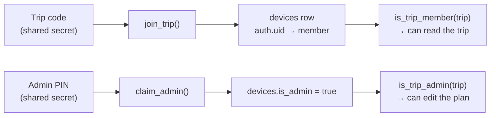

# Security model

There is no application server to enforce rules, so **Row Level Security (RLS) in Postgres is the security layer**. The anon key shipped in the JavaScript is public; what a phone may do depends on its signed-in user and the policies below.

## Trust chain

## Who can do what

| Table / resource | Read | Insert | Update / delete |
|---|---|---|---|
| `trips` | trip members | nobody via API | nobody via API |
| `members` | trip members | via `join_trip()` only | nobody |
| `devices` | own row | via RPCs only | via RPCs only |
| `stays`, `events`, `transport` | trip members | **admins** | **admins** |
| `restaurants` | trip members | members (as themselves) | creator or admin |
| `votes` | trip members | own votes | own votes |
| `expenses` | trip members | members (as themselves) | creator or admin |
| `messages` | trip members | members (as themselves) | not allowed |
| `locations` | trip members | own row | own row |
| `push_subscriptions` | own | own | own |
| `poll_votes` | trip members | own vote | own vote |
| `album_items` | trip members | members (as themselves) | uploader or admin |
| Storage `tickets` | trip members | admins | admins |
| Storage `media` | trip members | trip members | uploader (same phone) or admin |
| `push_log` | nobody via API | nobody via API | nobody via API |

## Design choices

- **`SECURITY DEFINER` helpers** (`is_trip_member`, `is_trip_admin`, …) are used inside policies so they can read `devices` without exposing it, and they set `search_path` to avoid hijacking.
- **Admin is per phone, not per name.** Picking an admin's name on your own phone does nothing without the PIN.
- **The PIN is stored as a bcrypt hash** (`pgcrypto`) and checked inside the database function. It never leaves the server.
- **Impersonation is blocked.** Insert policies require `member_id = current_member_id()` (or `created_by` / `added_by`), so you cannot post chat or expenses as someone else.
- **Tickets bucket is private.** Objects live under `<trip_id>/…`, and policies parse the folder name to check membership.
- **The Edge Function uses the service role key** (injected by Supabase, bypasses RLS) and is protected by the `x-webhook-secret` header, since it is deployed with `--no-verify-jwt`.

## Secrets and where they live

| Secret | Public? | Lives in |
|---|---|---|
| Supabase URL, anon key | Yes (public by design) | `.env` locally, Cloudflare build vars |
| VAPID public key | Yes | `.env`, Cloudflare build vars |
| VAPID private key | **No** | Supabase function secrets |
| `WEBHOOK_SECRET` | **No** | Supabase function secrets + webhook header |
| Service role key | **No** | Injected into the Edge Function by Supabase |
| Trip code | Shared with friends | Anyone with it can join as a new member |
| Admin PIN | Shared with admins | Hash in `trips.admin_pin_hash` |

## Known limitations

- **The trip code is the only gate to joining.** Anyone who learns it can read the whole trip and post to chat. Treat it like a password.
- **Admin PIN has no rate limit** beyond Supabase's API limits. Choose something longer than `8888` for a real trip (the seed file's value is a placeholder).
- **Sample data in `seed.sql` uses `DRAGON-27` / `8888`.** Change them before sharing.
- **Location is visible to all trip members** while Bolleke is active, and is retained in `locations` (expired, but not deleted) until the next Bolleke overwrites it.
