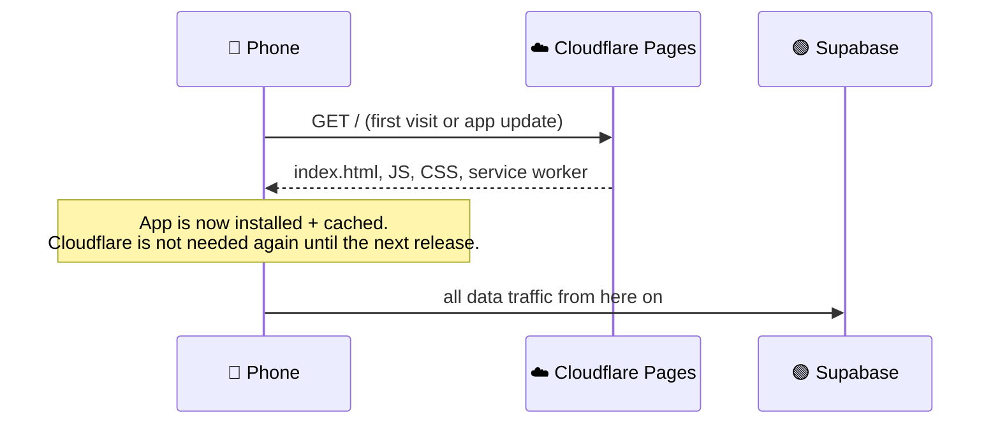
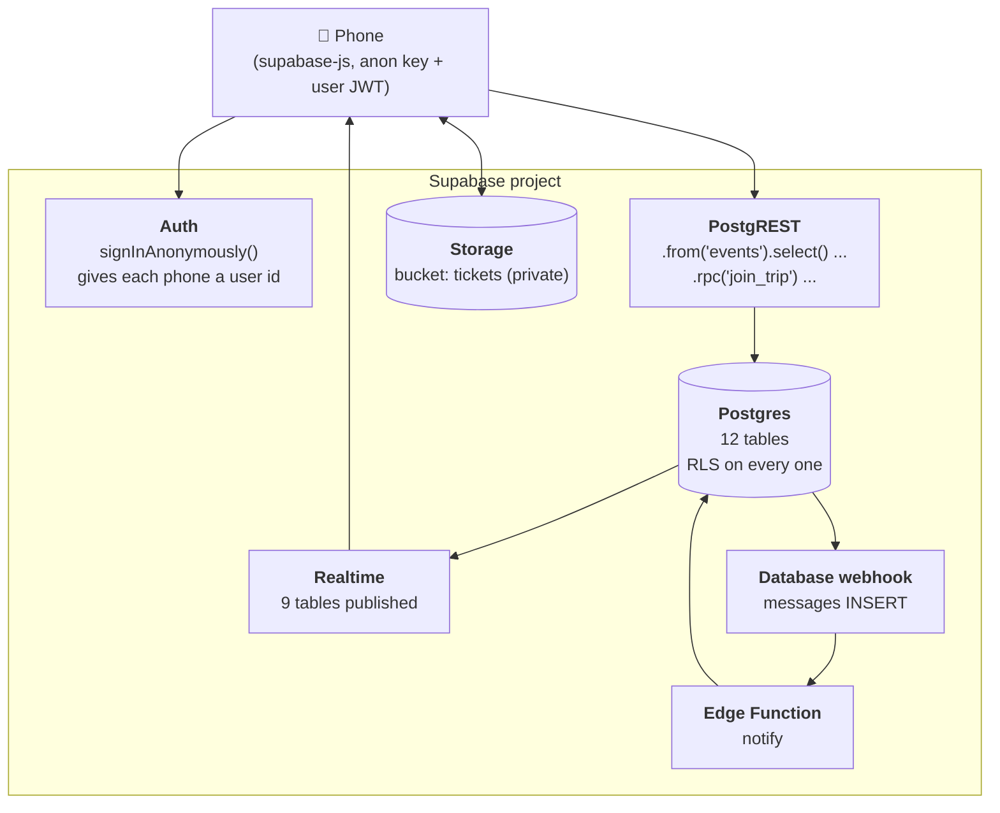

# Supabase vs Cloudflare: who does what

## At a glance

```mermaid
flowchart LR
    subgraph CF["☁️ Cloudflare Pages: 'the delivery truck'"]
        direction TB
        c1["Hosts static build files"]
        c2["Global CDN + HTTPS"]
        c3["Builds on every git push"]
        c4["Holds build-time env vars"]
    end
    subgraph SB["🟢 Supabase: 'the whole backend'"]
        direction TB
        s1["Postgres database"]
        s2["Anonymous auth"]
        s3["Row Level Security"]
        s4["Realtime live updates"]
        s5["File storage for tickets"]
        s6["Edge Function for push"]
        s7["DB webhook"]
    end
    CF ~~~ SB
```

| Concern | Cloudflare Pages | Supabase |
|---|---|---|
| Serves the app (HTML/JS/CSS/icons) | ✅ | |
| Build and deploy from git | ✅ | |
| HTTPS + CDN | ✅ | (API only) |
| Trip data (plan, hotels, food, expenses, chat) | | ✅ Postgres |
| Who is allowed to see/edit what | | ✅ RLS policies |
| Login | | ✅ Auth (anonymous) |
| Admin PIN check | | ✅ `claim_admin()` RPC |
| Live updates between phones | | ✅ Realtime |
| Ticket PDFs and images | | ✅ Storage |
| Sending push notifications | | ✅ Edge Function |
| Runs custom code at request time | ❌ not used | ✅ one function (`notify`) |
| Stores user data | ❌ never | ✅ |

## Cloudflare Pages: the "front door"

Cloudflare's job ends once the files reach the phone.

- **Input:** this git repo. Build command `npm run build`, output folder `dist`.
- **Output:** a static site such as `burglars-in-china.pages.dev`.
- **Config it holds:** three build variables, `VITE_SUPABASE_URL`, `VITE_SUPABASE_ANON_KEY` and `VITE_VAPID_PUBLIC_KEY`. Vite inlines these into the JavaScript at build time. All three are public by design.
- **What it never sees:** trip data, logins, locations or tickets. Those requests go from the phone straight to Supabase.

Because the service worker precaches the shell, the app opens even if Cloudflare is unreachable. The worker checks Cloudflare for a new version in the background (`registerType: 'autoUpdate'`).

## Supabase: the "everything else"

| Supabase feature | How this app uses it | Where in code |
|---|---|---|
| **Database** | 12 tables (trips, members, devices, stays, events, transport, restaurants, votes, expenses, messages, locations, push_subscriptions) | [0001_init.sql](../supabase/migrations/0001_init.sql) |
| **Auth** | Anonymous sign-in only. No email or password. | `supabase.auth.signInAnonymously()` in [store.tsx](../src/lib/store.tsx) |
| **RPC functions** | `join_trip`, `claim_admin`, `trip_preview`, plus helper functions used by policies | [0001_init.sql](../supabase/migrations/0001_init.sql) |
| **Row Level Security** | Every table. Members read their trip; admins write plan data. | [security.md](security.md) |
| **Realtime** | The phone subscribes to `postgres_changes` on 9 tables, filtered by `trip_id` | `store.tsx` |
| **Storage** | Private `tickets` bucket. Files are stored at `<trip_id>/<file>`. | [tickets.ts](../src/lib/tickets.ts) |
| **Database webhook** | Calls the Edge Function on each new `messages` row | Dashboard config (see README step 3.4) |
| **Edge Function `notify`** | Looks up subscribers, sends Web Push, removes dead subscriptions | [notify/index.ts](../supabase/functions/notify/index.ts) |
| **Edge Function `tick`** | Timed notifications: the morning summary | [tick/index.ts](../supabase/functions/tick/index.ts) |
| **Cron (`pg_cron` + `pg_net`)** | Calls `tick` every 5 minutes | [0002_scheduled_push.sql](../supabase/migrations/0002_scheduled_push.sql) |
| **Vault** | Holds the project URL and webhook secret the schedule uses | Set by hand (README step 3b) |

## Everything else (neither Supabase nor Cloudflare)

| Service | Used for | Called by |
|---|---|---|
| Amap / AutoNavi tiles | Map imagery that works in China | Phone, via Leaflet |
| Open-Meteo | 5-day weather forecast | Phone, [weather.ts](../src/lib/weather.ts) |
| Apple / Google / Mozilla push services | Final hop of a notification to the phone | Edge Function |

## Failure modes

| If this is down... | What happens |
|---|---|
| **Cloudflare** | Installed phones keep working from the service worker cache. New installs cannot load the app. |
| **Supabase** | The app shows the last saved copy of the trip (read-only in practice). Chat, votes, Bolleke and expenses fail until it returns. |
| **Edge Function** | Everything works, but nobody gets push notifications. Chat and Bolleke still appear when the app is opened. |
| **Amap tiles** | The map shows cached tiles only. Pins still render on a blank background. |
| **Open-Meteo** | The weather strip shows the last cached forecast, or nothing. |
